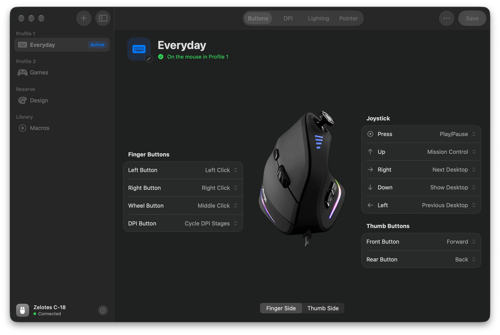
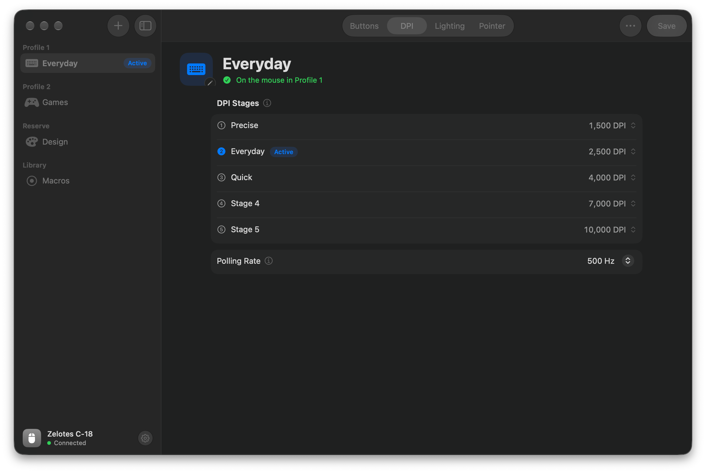
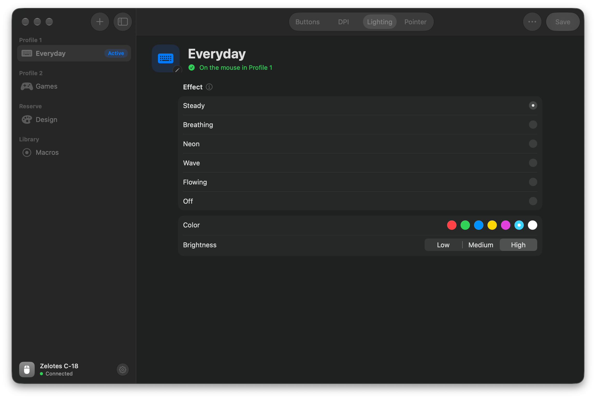
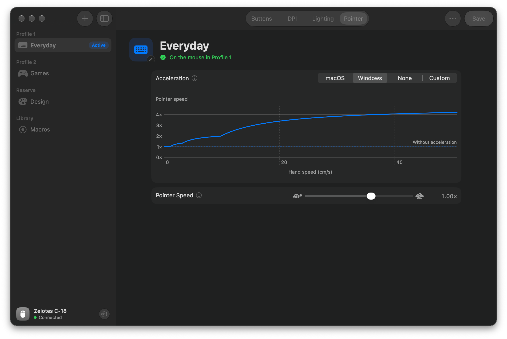

# ZelotesMac

A Mac app for the Zelotes C-18 vertical mouse. It sets the buttons, DPI, lighting and pointer acceleration, so you don't need the vendor's Windows software.

## Buttons

Give each of the 11 buttons a click, a keyboard shortcut, a media key, a desktop or Mission Control command, a DPI switch or a profile switch.



## DPI

Set five DPI stages, name them and pick the active one. Set the polling rate.



## Lighting

Pick an effect, a color, the brightness and the speed.



## Pointer

Turn off macOS acceleration for this mouse, or use Windows acceleration or your own curve. Other mice and the trackpad keep their settings.



## Presets

Keep as many setups as you like. Drag one onto Profile 1 or Profile 2 to put it on the mouse.

## Requirements

- macOS 26
- Xcode 26, to build
- A Zelotes C-18 (USB ID 12C9:2003)

## Build

```sh
./scripts/build-app.sh
open build/ZelotesMac.app
```

Run the tests with `swift test`.

## Good to know

- The mouse can't report its settings, so the app remembers what it wrote. Writing a preset to a profile replaces what was there.
- macOS forgets pointer settings when you unplug the mouse. A small helper puts them back when you plug it in, then quits. It needs ZelotesMac turned on in System Settings › General › Login Items.
- This project is not affiliated with Zelotes.

## License

MIT. See [LICENSE](LICENSE).
